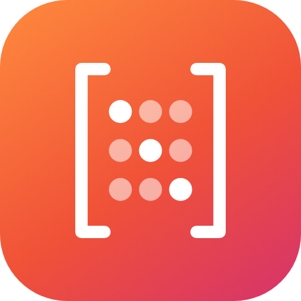

<p align="center">
  
</p>

<h1 align="center">LASwift</h1>

<p align="center">Fast linear algebra for Swift, powered by Accelerate.</p>

<p align="center">
  <a href="https://github.com/AlexanderTar/LASwift/actions/workflows/ci.yml"></a>
  <a href="https://codecov.io/gh/AlexanderTar/LASwift"></a>
  <a href="https://swiftpackageindex.com/AlexanderTar/LASwift"></a>
  <a href="https://swiftpackageindex.com/AlexanderTar/LASwift"></a>
  <a href="LICENSE"></a>
  <a href="https://alexandertar.github.io/LASwift/documentation/laswift/"></a>
</p>

LASwift gives Swift a `Matrix` type and a `Vector` (an array of `Double`) with the
operations you need for numerical code and machine learning. The syntax follows
Matlab and the Haskell library [hmatrix](https://hackage.haskell.org/package/hmatrix).
The work is done by Apple's Accelerate framework (vDSP, BLAS and LAPACK), so LASwift
runs on Apple platforms only.

## Features

For vectors and matrices:

- Arithmetic: `+`, `-`, `*`, element-wise `.*` and `./`, `abs`
- Exponents and logarithms: `**` and `.**` powers, `exp`, `log`, `log2`, `log10`, `sqrt`, `square`
- Trigonometry: `sin`, `cos`, `tan`, `asin`, `acos`, `atan`
- Statistics: `sum`, `mean`, `min`, `max`, `std` (sample by default), `normalize`
- `isApproximatelyEqual` for comparing floating-point results with a tolerance
- Seedable `rand` and `randn`

For matrices:

- Inverse, determinant, transpose and integer powers
- Eigenvalues and eigenvectors, including complex ones (`eig`, `eigvals`)
- Singular value decomposition (`svd`), generalized SVD (`gsvd`), Cholesky (`chol`)
- Least squares (`lstsqr`), `rank`, `unique`, 2-D `convolve`
- Slicing, concatenation, insertion and `diag`/`eye`/`zeros`/`ones` constructors

`Matrix` is a value type: `Sendable`, `Hashable` and compared exactly with `==`.

## Example

```swift
import LASwift

let A = Matrix([[2, 1], [1, 3]])
let b = Vector([1, 2])

let x = inv(A) * Matrix(b)          // solve A·x = b
let quadratic = A ** 2 + 3.0 .* eye(2, 2)
let squares = [1.0, 2.0, 3.0] .** 2 // [1, 4, 9]

let (V, D, _, _) = eig(A)           // right eigenvectors in the columns of V
assert(isApproximatelyEqual(A * V, V * D))
```

`**` and `.**` bind tighter than `*`, like exponentiation in maths. The old `^` and
`.^` still work in 1.0 but are deprecated, because `^` has the wrong precedence.

## Requirements

| Platform | Minimum |
| --- | --- |
| macOS | 13.3 |
| iOS | 16.4 |
| tvOS | 16.4 |
| watchOS | 9.4 |
| visionOS | 1.0 |

Building needs Xcode 26 or later (Swift 6.2 tools). These match [Package.swift](Package.swift).

## Installation

LASwift supports Swift Package Manager only. CocoaPods and Carthage were dropped in 1.0.

In a `Package.swift`:

```swift
dependencies: [
    .package(url: "https://github.com/AlexanderTar/LASwift.git", from: "1.0.0")
],
targets: [
    .target(name: "YourTarget", dependencies: ["LASwift"])
]
```

In Xcode, choose File > Add Package Dependencies, paste
`https://github.com/AlexanderTar/LASwift.git` and pick "Up to Next Major Version" from 1.0.0.

## Upgrading from 0.3

1.0 is a breaking release. See [Migrating from 0.3](CHANGELOG.md#migrating-from-03).

## Documentation

API documentation is on [GitHub Pages](https://alexandertar.github.io/LASwift/documentation/laswift/)
and the [Swift Package Index](https://swiftpackageindex.com/AlexanderTar/LASwift/documentation/laswift).

## Benchmarks

The [linalg-benchmarks](https://github.com/Alexander-Ignatyev/linalg-benchmarks) project
compares LASwift with Haskell hmatrix, Python NumPy, Octave and Go gonum.

## Contributing

Bug reports, ideas and pull requests are welcome. Read [CONTRIBUTING.md](CONTRIBUTING.md)
first, and follow the [Code of Conduct](CODE_OF_CONDUCT.md). Report security problems as
described in [SECURITY.md](SECURITY.md).

## Author

Alexander Taraymovich, taraymovich@me.com

## License

LASwift is available under the BSD-3-Clause license. See [LICENSE](LICENSE).
